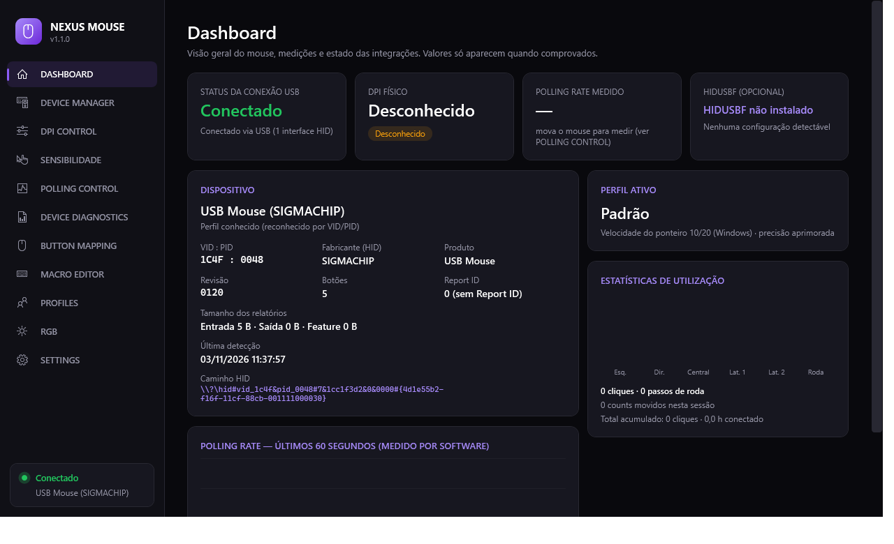
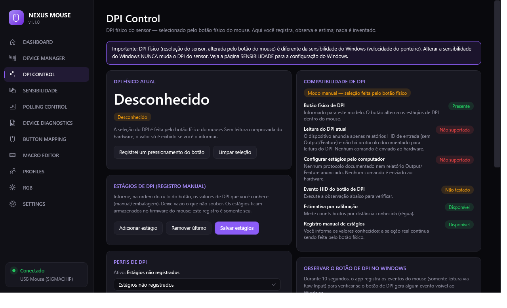
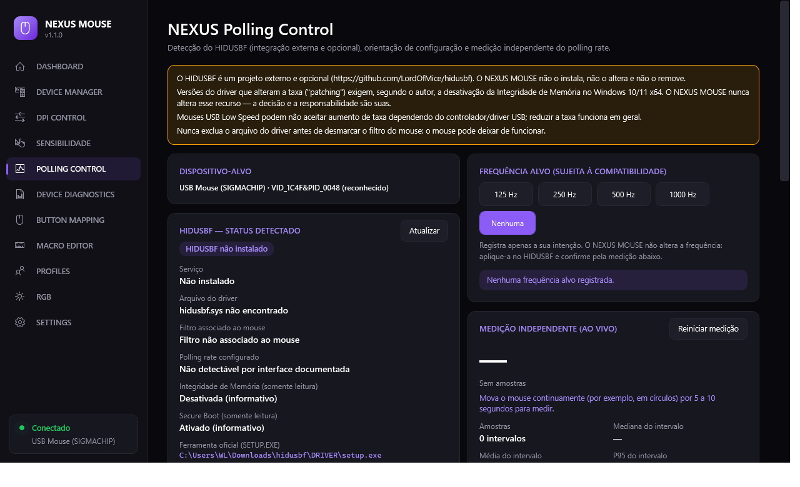
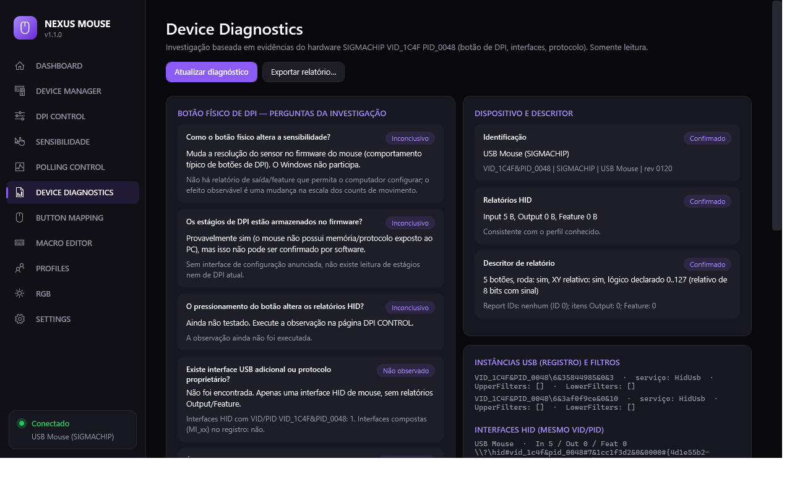

# NEXUS MOUSE

Aplicativo para Windows 10/11 (x64) que **gerencia, diagnostica e personaliza mouses USB**, com foco no
**SIGMACHIP "USB Mouse" — VID_1C4F PID_0048**. Tema escuro, interface em português do Brasil.

## Download
Baixe em **[Releases](../../releases/latest)**:
- **Instalador:** `NexusMouse-Setup-1.1.1-x64.exe` — instala só para o seu usuário, sem administrador, **não instala drivers**.
- **Portátil:** `NexusMouse-Portable-1.1.1-win-x64.zip` — extraia e execute `NexusMouse.exe` (dados na pasta `data`).

Não precisa instalar o .NET.

## O que ele faz
- **Dashboard:** conexão USB, dados do dispositivo, DPI físico (identificado / desconhecido / manual), polling medido, status do HIDUSBF e estatísticas de uso.
- **DPI Control:** trata o botão físico de DPI do mouse. Como não existe protocolo para ler o DPI, o app **não inventa valores**: você registra os estágios, observa o botão e pode estimar o DPI por calibração com régua.
- **Polling Control:** mede o polling rate por software e integra o **HIDUSBF** (incluído, sem modificações) para alterá-lo, sempre com sua confirmação.
- **Device Diagnostics, Device Manager, Sensibilidade do Windows, Button Mapping, Macro Editor, Profiles, RGB (diagnóstico) e Settings.**

## Segurança
Não modifica drivers do Windows, não envia comandos desconhecidos ao mouse, não altera Integridade de Memória/Secure Boot, e nada é instalado ou removido sem confirmação sua. Macros têm limites e exigem ação explícita.

## Avisos
- O **HIDUSBF** é um projeto de terceiros (<https://github.com/LordOfMice/hidusbf>) incluído sem alterações; use por sua conta e risco. Se o mouse parar de funcionar após usá-lo, desmarque *Filter On Device* no Setup do HIDUSBF ou remova o dispositivo no Gerenciador de Dispositivos.
- Distribuição binária apenas; o código-fonte não é publicado.
